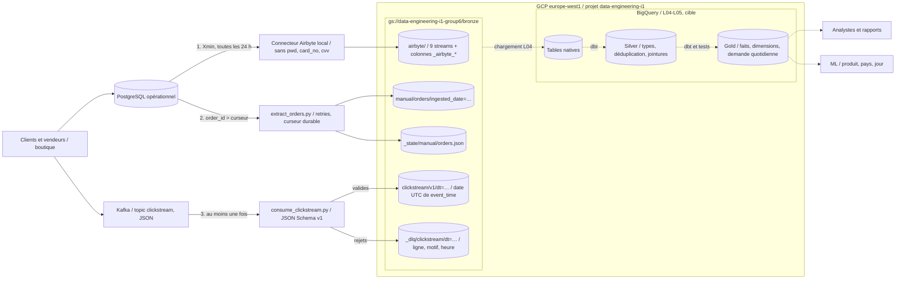

# Architecture d'Albert's Marketplace

Version L03 du 16 octobre 2026, à relire par le groupe. Le diagramme distingue
ce qui existe (traits pleins) de la cible des leçons suivantes (pointillés).

## Context

La boutique et les analystes interrogent aujourd'hui la même base PostgreSQL,
tandis que des exports nocturnes alimentent des tableurs. Les rapports ne
partagent pas une définition unique du chiffre d'affaires, et l'équipe ML
demande les unités par produit, pays et jour. La plateforme doit isoler les
lectures analytiques, conserver les données autorisées pour permettre le rejeu
et publier des modèles dont le grain et les règles sont explicites. Les
consignes imposent un bronze GCS en `europe-west1`, un warehouse BigQuery et,
à partir de L03, une ingestion relationnelle et un clickstream Kafka. Le schéma
legacy disponible ne contient pas toutes les informations métier supposées
dans la démonstration L01 : ces limites doivent rester visibles dans les modèles.

## Target architecture

La proposition [ADR-0001](adr/0001-target-architecture.md) retient deux étages :
stockage objet GCS puis tables natives BigQuery. Bronze, silver et gold sont
les niveaux de qualité successifs.

Trois chemins écrivent dans le bronze, chacun sous son préfixe, sans dépôt
manuel. Les trois ont écrit le 16 octobre 2026 ; la synchro Airbyte est encore
incomplète, faute de mémoire dans Docker. `orders` arrive par deux
chemins, avec des colonnes différentes : le [dictionnaire](data-dictionary.md)
dit d'où vient chaque table. Les modes, garanties et limites sont dans
l'[ADR-0003](adr/0003-ingestion-modes.md) et le
[suivi des pannes](ingestion-failure-modes.md).

## Layers

| Couche | Contenu prévu | Garanties à mettre en place | Lecteurs prévus |
|---|---|---|---|
| Bronze, GCS | Exports et événements acceptés, en Parquet ; rejets isolés dans `_dlq/` | Préserver les valeurs métier reçues, sans déduplication ni nettoyage ; exclure les secrets avant écriture ; tracer la provenance et le lot | Identités techniques d'ingestion et de chargement, ingénieurs autorisés |
| Chargement natif, BigQuery | Sous-ensemble de bronze nécessaire aux requêtes répétées | Représenter les lots chargés et rendre les doublons/reprises observables ; garder GCS comme source de rejeu | Transformations dbt et ingénieurs autorisés |
| Silver, BigQuery | Tables typées et normalisées, règles de déduplication et de jointure explicites | Un défaut traité à un endroit identifié ; clés et relations testées ; champs personnels limités selon l'usage | Modèles intermédiaires et modèles gold |
| Gold, BigQuery | `fct_order_items`, `fct_daily_demand` et dimensions | Grain déclaré et testé ; définition commune des mesures ; périmètre de données autorisé pour chaque consommateur | Analystes, rapports et compte ML |

`pwd`, `card_no` et `cvv` sont interdits à la frontière d'ingestion. Une
extraction de démonstration fondée sur le schéma L01 devrait aussi exclure ses
équivalents, notamment `password_hash` et `card_number`. La quarantaine n'est
pas une zone publique : un événement rejeté peut contenir des données personnelles.

## Ce qui est vérifié à ce stade

| Élément | État et preuve |
|---|---|
| Dépôt, équipe et CI | En place ; voir [CI](ci-cd.md). |
| Schéma et profil de l'export legacy | Inspection locale reproductible ; voir [le profil](evidence/l01-source-profile.json). |
| Architecture, règles et modèle ML | Propositions documentées pour relecture L01. |
| Bucket du groupe | `data-engineering-i1-group6`, créé le 16/10/2026 en `europe-west1`, accès uniforme, accès public bloqué. IAM : rôles par défaut du projet seulement. Pas de lifecycle (livrables L02 non traités). |
| Extracteur `orders` | 228 028 commandes puis 2 à la reprise ; voir [le compte rendu](evidence/l03-live-run.json). |
| Consumer clickstream et DLQ | 69 335 événements acceptés, 2 rejets volontaires retrouvés en DLQ, flux poursuivi. |
| Connecteur Airbyte | Connexion créée (Xmin, Incremental \| Append, 24 h) ; `pwd`, `card_no` et `cvv` absents des fichiers. Synchro partielle : 6 streams complets sur 9. Clé HMAC de compte utilisateur, à remplacer. |
| Warehouse et transformations | À réaliser en L04 et L05. |
| Docker, orchestration et Terraform | À réaliser de L06 à L08. |

Le dataset BigQuery devra être créé en `europe-west1`, comme le bucket.

## Decisions

| ADR | Décision | Statut |
|---|---|---|
| [0001](adr/0001-target-architecture.md) | Deux étages GCS et BigQuery, qualité bronze/silver/gold | Proposed |
| [0003](adr/0003-ingestion-modes.md) | Xmin pour le connecteur, curseur d'ID pour l'extracteur, Kafka au moins une fois | Proposed |

## Change log

| Date | Leçon | Changement |
|---|---|---|
| 2026-10-16 | L01 | Matrice des flux, comparaison des architectures, diagramme cible et limites du modèle quotidien. |
| 2026-10-16 | L03 | Bucket du groupe, trois chemins d'ingestion vers bronze, DLQ et état de l'extracteur. |

Mettre cette page à jour à la fin de chaque étape, en remplaçant les intentions
par les ressources et garanties réellement vérifiées. Le [suivi du projet](project-plan.md)
recense les preuves attendues avant de déclarer une étape terminée.
