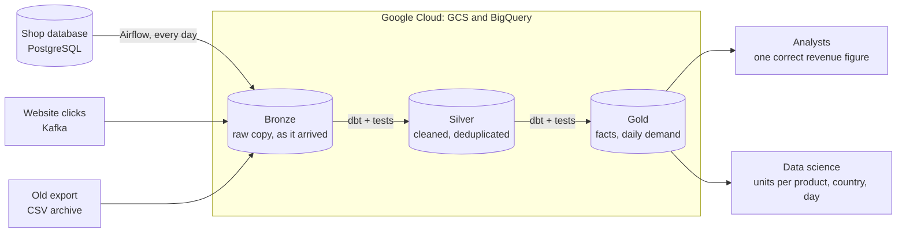
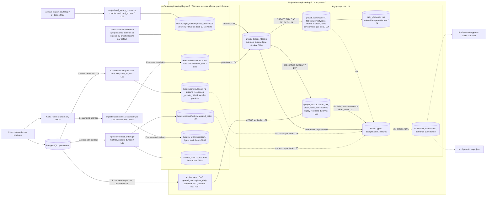

# Architecture d'Albert's Marketplace

Version L09 du 10 novembre 2026. Le bucket bronze du groupe contient l'export
legacy (L02) et les écritures des trois chemins d'ingestion L03 ; le jeu de
travail est chargé dans BigQuery (L04) ; dbt construit silver et gold (L05) ;
un DAG Airflow alimente chaque jour les commandes de bronze et relance dbt
(L07). Le reste du diagramme est la **cible proposée** en L01, à relire par le groupe.

## Overview

The platform in one picture. The detailed diagram, with every path and lesson,
is in [Architecture: built and target](#architecture-built-and-target).

## Context

La boutique et les analystes interrogent aujourd'hui la même base PostgreSQL,
tandis que des exports nocturnes alimentent des tableurs. Les rapports ne
partagent pas une définition unique du chiffre d'affaires, et l'équipe ML
demande les unités par produit, pays et jour. La plateforme doit isoler les
lectures analytiques, conserver les données autorisées pour permettre le rejeu
et publier des modèles dont le grain et les règles sont explicites. Les
consignes imposent un bronze GCS en `europe-west1`, un warehouse BigQuery et,
à partir de L03, une ingestion relationnelle et un clickstream Kafka. Le schéma
legacy disponible ne contient pas toutes les informations métier supposées
dans la démonstration L01 : ces limites doivent rester visibles dans les modèles.

## Architecture: built and target

La proposition [ADR-0001](adr/0001-target-architecture.md) retient deux étages :
stockage objet GCS puis tables natives BigQuery. Bronze, silver et gold sont
les niveaux de qualité successifs. Le layout de bronze est fixé par
l'[ADR-0002](adr/0002-bronze-layout.md). Les éléments en trait plein existent
et ont été vérifiés ; ceux en pointillés restent à construire.

Le diagramme montre quatre producteurs du bronze, sans dépôt manuel :

- **L'archive legacy**, chargée une fois en L02 sous `legacy/`.
- **Le connecteur Airbyte**, sous `airbyte/`. Sa première synchro est
  incomplète, faute de mémoire dans Docker.
- **L'extracteur SQL**, sous `manual/orders/`, avec son curseur sous `_state/`.
- **Le consumer Kafka**, sous `clickstream/v1/`, et ses rejets sous `_dlq/`.

Depuis L07, un cinquième producteur écrit directement dans BigQuery : le DAG
Airflow extrait chaque jour les commandes et leurs lignes de la période du run,
puis les fusionne par `MERGE` dans `group6_bronze.orders_raw` et
`order_items_raw`, que lit dbt ([orchestration](orchestration.md),
[ADR-0007](adr/0007-idempotency.md)).

Chaque préfixe a un seul producteur identifié. `orders` arrive par trois
chemins, avec des types différents : le [dictionnaire](data-dictionary.md#flux-l03)
dit d'où vient chaque table. Modes, garanties et limites sont dans
l'[ADR-0003](adr/0003-ingestion-modes.md) et le
[suivi des pannes](ingestion-failure-modes.md).

## Layers

| Couche | Contenu | Garanties | Lecteurs |
|---|---|---|---|
| Bronze, GCS | **L02 :** `legacy/` (27 tables). **L03 :** `airbyte/`, `manual/orders/`, `clickstream/v1/`, rejets dans `_dlq/` | Legacy : valeurs **identiques au CSV**, stockées en texte, vérifiées cellule par cellule, un lot = une partition `ingested_date`. L03 : types de la source, provenance Kafka ou colonnes `_airbyte_*`, livraison au moins une fois (doublons possibles). Partout : ni nettoyage ni déduplication ; `pwd`, `card_no` et `cvv` exclus avant écriture | **Aujourd'hui :** tous les rôles du projet (voir [IAM](../infra/iam.md)). **Cible :** comptes d'ingestion et de chargement, membres du groupe |
| Chargement natif, BigQuery | Sous-ensemble de bronze nécessaire aux requêtes répétées | Représenter les lots chargés et rendre les doublons ou reprises observables ; garder GCS comme source de rejeu | Transformations dbt et ingénieurs autorisés |
| Silver, BigQuery | Tables typées et normalisées, règles de déduplication et de jointure explicites | Un défaut traité à un endroit identifié ; clés et relations testées ; `phone`, `zip` et `p_id` gardés en texte ; champs personnels limités selon l'usage | Modèles intermédiaires et modèles gold |
| Gold, BigQuery | `fct_order_items`, `fct_daily_demand` et dimensions | Grain déclaré et testé ; définition commune des mesures ; périmètre de données autorisé pour chaque consommateur | Analystes, rapports et compte ML |

`pwd`, `card_no` et `cvv` sont interdits à la frontière d'ingestion : absents
du bronze legacy, ils sont aussi exclus à la source en L03 (décochés dans le
connecteur ; l'extracteur ne lit que `orders`). Une extraction de démonstration fondée sur le schéma L01 devrait aussi
exclure leurs équivalents, notamment `password_hash` et `card_number`. Les
colonnes personnelles restantes sont recensées dans le
[dictionnaire de données](data-dictionary.md). La quarantaine n'est pas une
zone publique : un événement rejeté peut contenir des données personnelles.

## Ce qui est vérifié à ce stade

| Élément | État et preuve |
|---|---|
| Dépôt, équipe et CI | En place ; voir [CI](ci-cd.md). |
| Schéma et profil de l'export legacy | Inspection reproductible ; voir [le profil L01](evidence/l01-source-profile.json). |
| Bucket du groupe | `gs://data-engineering-i1-group6`, `europe-west1`, Standard, accès uniforme, accès public bloqué, suppression réversible de 7 jours ; lu avec `gcloud storage buckets describe`. |
| Bronze legacy | 27 tables, 2 928 485 lignes, 62 Mo de Parquet zstd, chacune comparée à son CSV ; voir [le manifeste](evidence/l02-bronze-legacy-manifest.json). |
| Lifecycle | Défini dans [infra/lifecycle.json](../infra/lifecycle.json), limité à `bronze/legacy/` : Nearline à 45 jours (valeur réelle adoptée en L08), Coldline à 90, Archive à 365. |
| IAM | Six liaisons par défaut, aucune ajoutée ; moindre privilège non atteint ; voir [infra/iam.md](../infra/iam.md). |
| Coûts | Moins de $0.002 par mois ; voir [costs.md](costs.md). |
| Extracteur `orders` (L03) | 228 028 commandes puis 2 à la reprise ; voir [le compte rendu](evidence/l03-live-run.json). |
| Consumer clickstream et DLQ (L03) | 69 335 événements acceptés, 2 rejets volontaires retrouvés en DLQ, flux poursuivi. |
| Connecteur Airbyte (L03) | Xmin, Incremental \| Append, 24 h ; `pwd`, `card_no` et `cvv` absents des fichiers. Synchro partielle : 6 streams complets sur 9 ; voir [la preuve](evidence/l03-airbyte-sync.json). Clé HMAC de compte utilisateur, à remplacer. |
| Warehouse (L04) | `group6_warehouse`, `europe-west1` : 7 tables natives aux comptes du bronze, `orders` et `order_items` partitionnées par mois (37 partitions), vue `daily_demand` ; avant/après mesurés cache désactivé, plafond de 1 GiB vu en échec ; voir [les mesures](evidence/l04-warehouse-measurements.json) et [les réglages](warehouse-tuning.md). |
| Transformations | À réaliser en L05. |
| Docker (L06) | Deux images privées `group6-ingestion` et `group6-transform` dans Artifact Registry `dataeng`, `europe-west1`, base et dépendances fixées, UID 10001. Reproduction d'ingestion après suppression locale réussie ; rétention refusée par IAM, voir [le transcript](reproduce.md). |
| Orchestration (L07) | DAG `group6_marketplace_daily` sur Airflow 3.3.2 local : run planifié et back-fill du 15 au 16 septembre réussis, prédiction exacte (+468 commandes, +856 lignes), rejeu sans effet ; alerte e-mail reçue après les retries ; quality gate déclenchée par une ligne dupliquée. Voir [orchestration.md](orchestration.md). |
| Terraform (L08) | Bucket, quatre datasets et cinq membres IAM dataset déclarés, imports conservés, état GCS partagé versionné ; plans réels sans changement et dérive lifecycle détectée puis écrasée. Compte de service non adoptable avec les accès disponibles ; voir [infra.md](infra.md) et [ADR-0008](adr/0008-remote-state.md). |
| FinOps (L09) | Quatre labels appliqués par Terraform au bucket et aux datasets ; futurs jobs dbt/bq attribués ; registre et sonde d'élagage des partitions mesurée. Budget préparé mais création bloquée par l'API désactivée ; voir [costs.md](costs.md) et [ADR-0009](adr/0009-cost-attribution.md). |

## Decisions

| ADR | Décision | Statut |
|---|---|---|
| [0001](adr/0001-target-architecture.md) | Deux étages GCS et BigQuery, qualité bronze/silver/gold | Proposed |
| [0002](adr/0002-bronze-layout.md) | Bronze legacy en Parquet zstd, colonnes texte, partition `ingested_date` | Proposed |
| [0003](adr/0003-ingestion-modes.md) | Xmin pour le connecteur, curseur d'ID pour l'extracteur, Kafka au moins une fois | Proposed |
| [0004](adr/0004-warehouse-pricing.md) | BigQuery à la demande, plafonné à 1 GiB par requête | Proposed |
| [0006](adr/0006-image-tags.md) | Images privées, tags de build datés, rollback par digest et rétention | Proposed ; suppression bloquée par IAM |
| [0008](adr/0008-remote-state.md) | État Terraform partagé dans GCS, versions et verrouillage | Proposed pour relecture ; backend vérifié |
| [0009](adr/0009-cost-attribution.md) | Labels des ressources et jobs, estimation séparée de la facture, projets distincts à dix équipes | Proposed pour relecture ; alerte budget bloquée |

## Change log

| Date | Leçon | Changement |
|---|---|---|
| 2026-10-16 | L01 | Matrice des flux, comparaison des architectures, diagramme cible et limites du modèle quotidien. |
| 2026-10-16 | L02 | Bucket du groupe, bronze legacy chargé, layout mesuré, lifecycle, IAM et coûts ; diagramme distinguant le construit de la cible. |
| 2026-10-16 | L03 | Trois chemins d'ingestion vers bronze (connecteur, extracteur, consumer), DLQ et état de l'extracteur. |
| 2026-10-26 | L04 | Tables externes sur bronze, jeu de travail chargé en tables natives réglées, vue `daily_demand`, plafond par requête. Airbyte et l'extracteur rejoignent silver en L05, pas le chargement natif. |
| 2026-11-03 | L06 | Deux images construites et publiées, reproduction figée vérifiée après suppression/pull. Rétention tentée mais permission de suppression manquante. |
| 2026-11-06 | L07 | DAG Airflow quotidien : extraction par période, `MERGE` dans deux tables bronze natives, dbt. Sources dbt `orders` et `order_items` repointées sur ces tables. |
| 2026-11-10 | L08 | Configuration alignée sur l'état distant existant, lifecycle réel à 45 jours adopté, dérive 45 → 46 détectée puis restaurée ; CI sans accès cloud et ADR d'état distant. |
| 2026-11-10 | L09 | Labels appliqués, registre daté et analyse des pics de jobs ; sonde mensuelle à résultats identiques avec 98,79 % de scan en moins, minimum facturé inchangé. Budget à activer avec l'administrateur. |

Mettre cette page à jour à la fin de chaque étape, en remplaçant les intentions
par les ressources et garanties réellement vérifiées.
