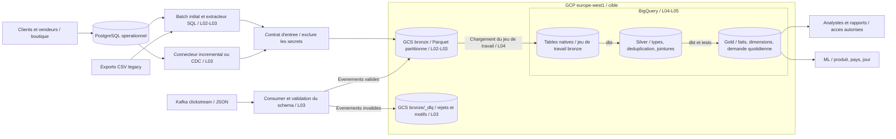

# Architecture d'Albert's Marketplace

Version L01 du 16 octobre 2026. **Cible proposée**, à relire par le groupe.
Ce diagramme présente les composants à construire au fil du cours ; il ne
constitue pas un inventaire de ressources cloud déjà déployées.

## Context

La boutique et les analystes interrogent aujourd'hui la même base PostgreSQL,
tandis que des exports nocturnes alimentent des tableurs. Les rapports ne
partagent pas une définition unique du chiffre d'affaires, et l'équipe ML
demande les unités par produit, pays et jour. La plateforme doit isoler les
lectures analytiques, conserver les données autorisées pour permettre le rejeu
et publier des modèles dont le grain et les règles sont explicites. Les
consignes imposent un bronze GCS en `europe-west1`, un warehouse BigQuery et,
à partir de L03, une ingestion relationnelle et un clickstream Kafka. Le schéma
legacy disponible ne contient pas toutes les informations métier supposées
dans la démonstration L01 : ces limites doivent rester visibles dans les modèles.

## Target architecture

La proposition [ADR-0001](adr/0001-target-architecture.md) retient deux étages :
stockage objet GCS puis tables natives BigQuery. Bronze, silver et gold sont
les niveaux de qualité successifs.

L'extraction batch et le connecteur sont des chemins distincts à documenter en
L03 ; ils ne doivent pas devenir deux producteurs non identifiés d'une même
table bronze. Le choix des curseurs, la garantie de livraison, le schéma des
événements et la gestion des rejets feront l'objet de l'ADR-0003 et des essais
de panne. Les mécanismes décrits dans ce diagramme ne sont pas encore implémentés.

## Layers

| Couche | Contenu prévu | Garanties à mettre en place | Lecteurs prévus |
|---|---|---|---|
| Bronze, GCS | Exports et événements acceptés, en Parquet ; rejets isolés dans `_dlq/` | Préserver les valeurs métier reçues, sans déduplication ni nettoyage ; exclure les secrets avant écriture ; tracer la provenance et le lot | Identités techniques d'ingestion et de chargement, ingénieurs autorisés |
| Chargement natif, BigQuery | Sous-ensemble de bronze nécessaire aux requêtes répétées | Représenter les lots chargés et rendre les doublons/reprises observables ; garder GCS comme source de rejeu | Transformations dbt et ingénieurs autorisés |
| Silver, BigQuery | Tables typées et normalisées, règles de déduplication et de jointure explicites | Un défaut traité à un endroit identifié ; clés et relations testées ; champs personnels limités selon l'usage | Modèles intermédiaires et modèles gold |
| Gold, BigQuery | `fct_order_items`, `fct_daily_demand` et dimensions | Grain déclaré et testé ; définition commune des mesures ; périmètre de données autorisé pour chaque consommateur | Analystes, rapports et compte ML |

`pwd`, `card_no` et `cvv` sont interdits à la frontière d'ingestion. Une
extraction de démonstration fondée sur le schéma L01 devrait aussi exclure ses
équivalents, notamment `password_hash` et `card_number`. La quarantaine n'est
pas une zone publique : un événement rejeté peut contenir des données personnelles.

## Ce qui est vérifié à ce stade

| Élément | État et preuve |
|---|---|
| Dépôt, équipe et CI | En place ; voir [CI](ci-cd.md). |
| Schéma et profil de l'export legacy | Inspection locale reproductible ; voir [le profil](evidence/l01-source-profile.json). |
| Architecture, règles et modèle ML | Propositions documentées pour relecture L01. |
| Bucket du groupe, IAM et lifecycle appliqué | Non vérifiés dans ce lot ; à prouver en L02, sans confondre avec le bucket individuel de l'exercice. |
| Pipelines, warehouse et transformations | À réaliser de L03 à L05. |
| Docker, orchestration et Terraform | À réaliser de L06 à L08. |

Le dataset BigQuery devra être configuré dans la région choisie pour le bucket.
La clé de partition et le codec seront décidés dans l'ADR-0002, avec les
mesures de L02 ; aucun nom de bucket du groupe n'est encore établi ici.

## Decisions

| ADR | Décision | Statut |
|---|---|---|
| [0001](adr/0001-target-architecture.md) | Deux étages GCS et BigQuery, qualité bronze/silver/gold | Proposed |

## Change log

| Date | Leçon | Changement |
|---|---|---|
| 2026-10-16 | L01 | Matrice des flux, comparaison des architectures, diagramme cible et limites du modèle quotidien. |

Mettre cette page à jour à la fin de chaque étape, en remplaçant les intentions
par les ressources et garanties réellement vérifiées. Le [suivi du projet](project-plan.md)
recense les preuves attendues avant de déclarer une étape terminée.
