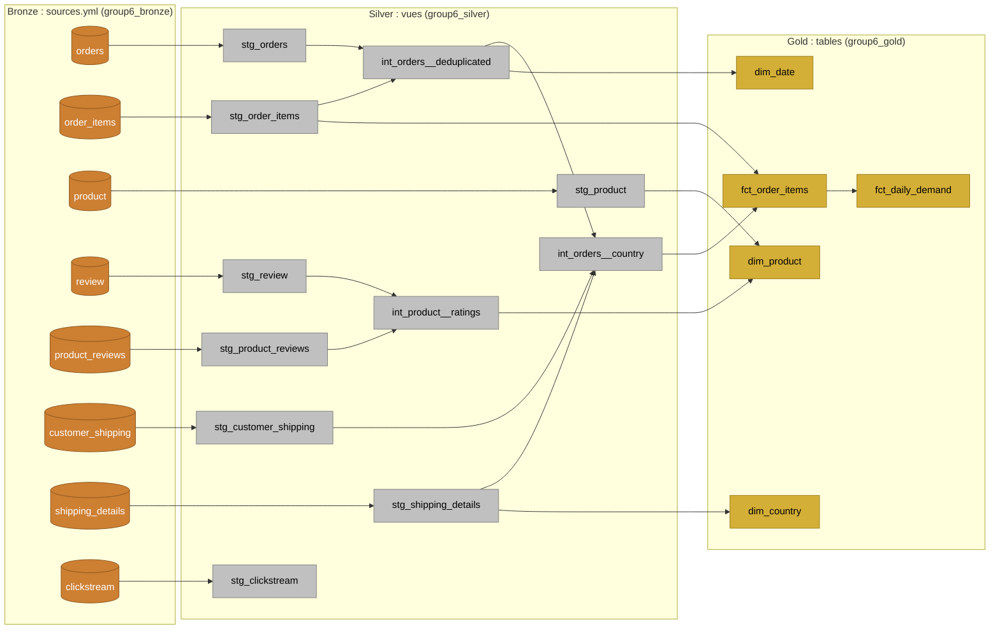

# Lignage dbt (L05)

Graphe des modèles de [`transform/`](../transform/README.md), relevé dans
`transform/target/manifest.json` (`dbt parse`, dbt 1.11). Il se régénère avec :

```bash
cd transform
dbt docs generate --profiles-dir .
dbt docs serve --profiles-dir .   # onglet « Lineage graph »
```



`stg_clickstream` n'alimente encore aucun modèle gold : il est déclaré pour sa
fraîcheur et son dédoublonnage, en attendant un besoin de consommation.

## Si la source la plus en amont changeait de forme demain

La source dont tout dépend est **`orders`** : elle alimente
`int_orders__deduplicated`, donc les deux faits, `dim_date` et la totalité de
la mesure de demande. Si sa forme changeait (le passage du legacy au flux
Airbyte typé est le cas prévu), il faudrait regarder, dans l'ordre :
`stg_orders`, seul endroit où ses colonnes sont nommées et typées ; la règle de
`int_orders__deduplicated`, qui suppose que l'export écrit chaque commande deux
fois, une hypothèse que le flux Airbyte ne vérifiera probablement pas, et que
le test `assert_each_kept_order_has_one_twin` signalera dès la première
commande non dédoublée ; puis `int_orders__country` et `fct_order_items`, dont
le grain `(order_id, p_id)` et le test de conservation des unités disent si la
nouvelle forme multiplie ou perd des lignes. `dbt ls --select stg_orders+`
donne la liste exacte des modèles et tests à relancer.
