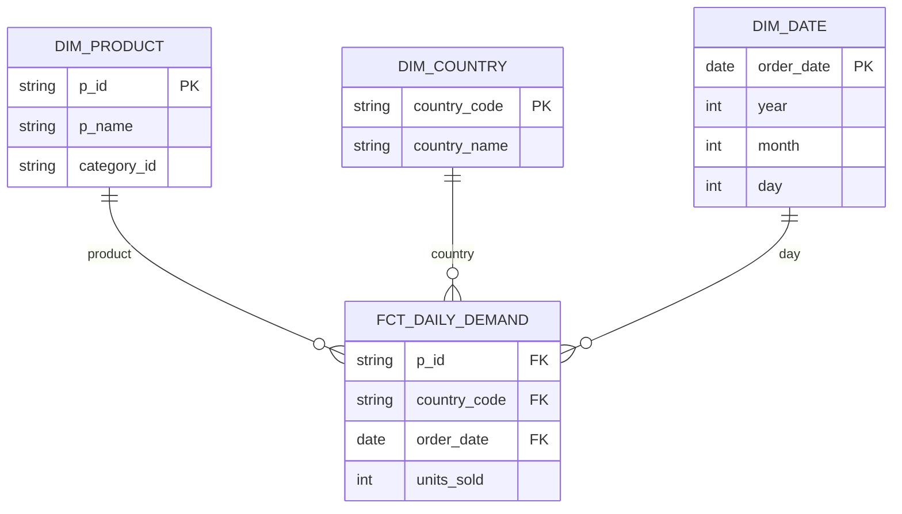

# Demande quotidienne par produit et pays

Esquisse L01 proposée à la relecture. La construction et les tests dbt sont
prévus en L05 dans `transform/`. Le nom cible est `fct_daily_demand` ;
`ml_units_daily`, utilisé dans le notebook L01, désigne le même besoin métier.

## 1. Business process

Mesurer les quantités figurant dans les commandes d'Albert's Marketplace pour
alimenter l'analyse de demande et le jeu d'entraînement ML quotidien.

Le besoin parle d'unités vendues. **Convention proposée pour le schéma legacy :**
`units_sold` désigne ici `SUM(order_items.qty)` sur les commandes présentes dans
la source. Celle-ci n'a pas de statut de paiement, d'annulation ou de retour :
cette mesure ne certifie donc ni des ventes payées ni des ventes nettes.
Cette limite devra figurer dans la description du modèle et être validée par
le groupe ; une mesure de ventes payées nécessite une source complémentaire.

## 2. Grain

**Une ligne par produit, par pays et par jour de commande.**

`One row per product per country per day. GRAIN: (p_id, country_code, order_date).`

La table est creuse : seuls les triplets comportant des lignes de commande
sont produits. Une absence de ligne ne prouve pas une demande nulle si une
partition source est manquante. Une grille dense avec des zéros constituerait
une transformation ML distincte, après validation de la complétude.

## 3. Dimensions

| Dimension | Clé cible | Source disponible | Règle proposée |
|---|---|---|---|
| `dim_product` | `p_id`, STRING | `product.p_id`, `p_name`, `category_id` | Conserver l'identifiant comme texte, notamment ses zéros initiaux ; une ligne par produit. |
| `dim_country` | `country_code`, STRING | `shipping_details.country` | Normaliser les libellés observés en DE, FR, IT, ES, NL, BE ; réserver `UNKNOWN` aux cas non résolus. |
| `dim_date` | `order_date`, DATE | `orders.order_date` | Conserver la date source, déjà dépourvue d'heure ; ne pas inventer de conversion de fuseau. |

Le pays demandé est idéalement celui de la livraison au moment de la commande.
Le legacy ne stocke pas cette relation historique. Le seul chemin disponible est :

```text
order_items.order_id -> orders.order_id
order_items.p_id -> product.p_id
orders.buyer_id -> customer_shipping.c_id [is_default = 1]
customer_shipping.address_id -> shipping_details.address_id
```

Le pays obtenu est donc **un proxy fondé sur l'adresse par défaut actuelle**.
Un changement d'adresse peut réaffecter les commandes anciennes lors d'un
recalcul ; ce biais est particulièrement important pour les analyses historiques
et le ML. Il ne faut pas le décrire comme un pays historique observé. Ajouter
un lien commande-adresse ou un historique temporel permettrait de corriger ce
problème, au prix d'une nouvelle règle et d'un nouvel ADR.

Filtrer `is_default = 1` avant la jointure évite de multiplier chaque commande
par toutes les adresses du client. En cas de plusieurs adresses par défaut,
traiter le cas comme une anomalie et ne pas choisir arbitrairement la première.
Une adresse manquante conserve les unités dans `UNKNOWN`, avec un contrôle de
qualité visible. Ne joindre aucun avis à cette table : les avis nécessitent
leur propre agrégation préalable et ne définissent pas la demande.

## 4. Facts

| Mesure | Définition | Additivité et limite |
|---|---|---|
| `units_sold`, INTEGER | Somme de `qty` après maîtrise des jointures | Additive sur produit, pays et date ; unités commandées observées selon la convention ci-dessus, sans preuve de paiement. |
| `order_count`, INTEGER, facultatif | Nombre distinct de `order_id` pour le triplet | Non additive entre produits : une même commande peut contenir plusieurs produits. |

Le chiffre d'affaires, le prix catalogue actuel et les avis ne sont pas des
mesures de cette table. Le prix de vente historique disponible est
`order_items.price_at_purchase`, à conserver pour le fait de lignes de commande ;
`product.price` ne doit pas lui être substitué.



## Colonnes à transporter dès l'ingestion

| Table | Colonnes indispensables au modèle |
|---|---|
| `orders` | `order_id`, `buyer_id`, `order_date` |
| `order_items` | `order_id`, `p_id`, `qty`, `price_at_purchase` |
| `product` | `p_id`, `p_name`, `category_id` |
| `customer_shipping` | `c_id`, `address_id`, `is_default` |
| `shipping_details` | `address_id`, `country` |

Il s'agit du minimum requis pour ce modèle, pas d'une instruction pour retirer
les autres colonnes métier du bronze. Les colonnes autorisées reçues restent
inchangées ; les secrets sont exclus à la frontière. Noms de clients, rue,
téléphone, `buyer_id` et `address_id` ne sont pas exposés dans l'agrégat ML.

## Preuves disponibles et contrôles L05

Le [profil de l'archive](../evidence/l01-source-profile.json) donne 408 560
lignes, aucun doublon `(order_id, p_id)`, aucun client avec plusieurs adresses
par défaut et aucune commande sans adresse par défaut dans ce snapshot.
Ces constats ne garantissent pas le comportement des ingestions futures.

Les tests à implémenter en L05 devront vérifier :

- unicité et non-nullité de `(p_id, country_code, order_date)` ;
- unicité des dimensions et relations de chaque fait vers ces dimensions ;
- unicité du candidat `(order_id, p_id)` pour `fct_order_items` ;
- cardinalité des adresses par défaut et absence de multiplication aux jointures ;
- conservation de `SUM(qty)` entre les lignes éligibles et la table quotidienne ;
- quantités strictement positives pour le périmètre courant, et pays non résolus visibles ;
- absence de colonnes personnelles dans la sortie ML et fraîcheur des sources.

Le notebook L01 utilise `product_id`, `ship_country_code`, `created_at` et
`status` dans une base simulée. Ces colonnes n'existent pas dans cet export :
son filtre sur le statut ne peut donc pas être repris tel quel.
